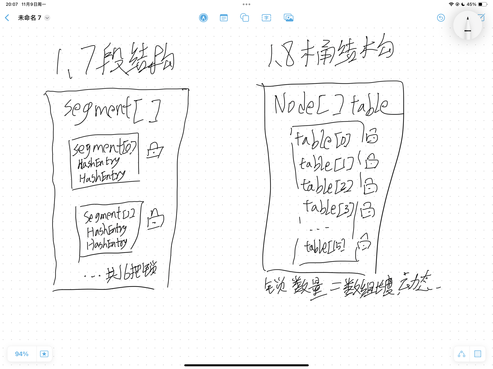

# ConcurrentHashMap 的线程安全设计

## 一句话结论

> CHM 1.8 = 数组 + 链表 + 红黑树；空桶用 CAS 插入，非空桶 synchronized 锁桶头遍历，计数用 LongAdder 思想。不允许 null 的 key 和 value。

## 原理（自己画，不要贴别人的图）

- 1.7 分段锁：默认 16 个 Segment（可调），每段一把 ReentrantLock——锁粒度粗、初始化内存开销大、size() 要锁全段累加
- 1.8 改造：
  - 空桶插入：casTabAt 乐观锁，失败重试
  - 非空桶：synchronized 锁桶头节点，遍历 + 尾插（多步操作单次 CAS 做不了）
  - 计数：baseCount + CounterCell 数组，size() 弱一致性
  - 扩容：协助扩容（其他线程帮助迁移）
- 为什么禁 null：get 返回 null 无法区分"key 不存在"和"value 就是 null"；HashMap 靠 containsKey 二次确认，但并发下 get 和 containsKey 合不成原子判断

## 边界与坑

| 场景 | 会发生什么 | 怎么规避 |
|---|---|---|
| put(null, v) 或 put(k, null) | NPE | 调用前判空 |
| size() | 并发写入时是估算值（弱一致性） | 精确计数需完全无并发写或用原子累加 |
| 迭代中其他线程修改 | 迭代器是弱一致性，不抛异常但可能看不到新元素 | 需要强一致性换同步容器或加锁 |
| 1.7 高并发扩容 | 段内竞争激烈 | 1.8 桶级锁 + 协助扩容解决 |

## 我项目里在哪用到

> 健身项目目前没有用 CHM 的场景——单机部署 + 无多线程共享写。
> 面试如实说，并补一句：本地缓存若在并发场景会考虑 CHM 或加锁，而不是盲目上 CHM。

## 追问 3 个（自己先答，再对照笔记）

1. 1.7 的分段锁为什么被 1.8 淘汰？
2. 1.8 的 put 里，CAS 和 synchronized 分别保护哪一步？
3. 为什么 CHM 不允许 null，HashMap 却允许？

## 我原来以为 vs 其实

- 原来以为：1.7 段数上限锁死 16 个线程。
  其实：默认 16 但可调，真正的痛点是锁粒度粗、内存开销和 size() 代价。
- 原来以为：CAS 是"判断桶内是否改变，没变就插"。
  其实：CAS 只负责空桶的首个插入；非空桶的遍历插入必须上锁。
- 原来以为：禁 null 是"无法判断是否在过程中被改变"。
  其实：核心是 get 的返回值歧义——分不清"不存在"和"值为 null"，且并发下无法原子地二次确认。

## 三个月后自测

> 合上笔记，能不能默画出 1.7 段结构图 vs 1.8 桶锁结构图，并讲清两者锁粒度的差别？能 → 标 done。
