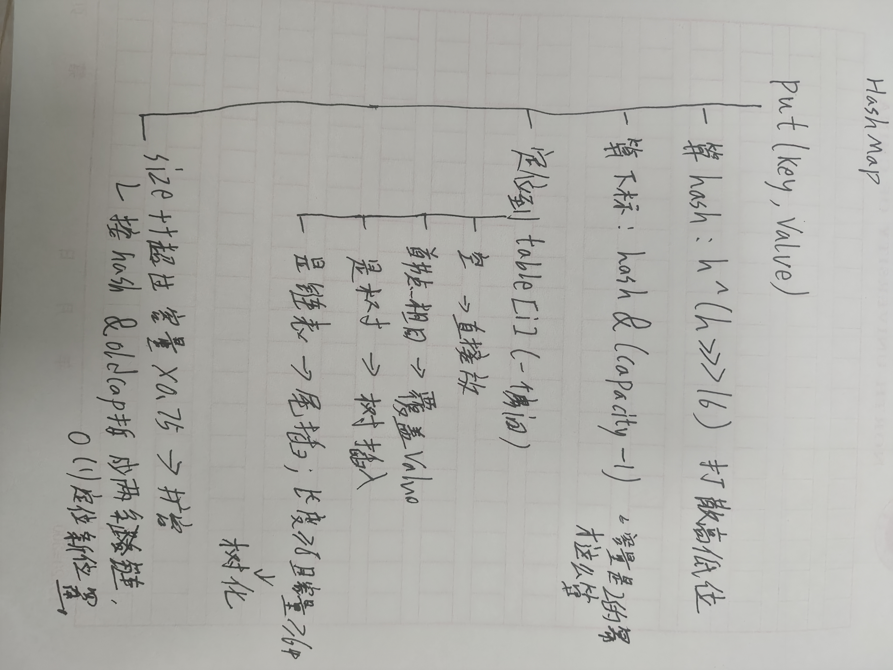

# HashMap 的 put 全流程

## 一句话结论

> HashMap = 数组 + 链表 + 红黑树。默认容量 16、负载因子 0.75、扩容翻倍；链表 ≥ 8 且容量 ≥ 64 才树化，否则只扩容。

## 原理（自己画，不要贴别人的图）

- hash 扰动：h ^ (h >>> 16)，让高 16 位参与低位运算，减少碰撞
- 定位桶：(n - 1) & hash，容量是 2 的幂时等价取模
- putVal 三分支：数组空位直接放 / 链表尾插并计数 / 红黑树插入
- 扩容：新容量翻倍；e.hash & oldCap 判断——为 0 留原位，否则去高位桶，只落两个位置
- 树化：链表 ≥ 8 且容量 ≥ 64，两个条件缺一不可（泊松分布：碰撞 8 次概率约千万分之一）

## 边界与坑

| 场景 | 会发生什么 | 怎么规避 |
|---|---|---|
| 链表到 8 但容量小 | 不树化，先扩容 | 树化看两个条件 |
| key 为 null | 放第 0 桶 | — |
| 初始容量传 10 | 实际 16（取 2 的幂） | 预估用 expectedSize / 0.75 + 1 |
| 并发 put | JDK7 死循环，JDK8 丢数据 | 换 ConcurrentHashMap |

## 我项目里在哪用到

> 健身项目目前没有显式用 HashMap 的场景（缓存是 W13 的事）。
> 面试就说实话：读多写少、单机、无并发写；等加缓存时用 Map<LocalDate, List<Slot>> 做本地缓存。

## 追问 3 个（自己先答，再对照笔记）

1. 为什么容量一定是 2 的幂？
2. 扩容时元素为什么只落到两个位置？
3. 树化阈值 8 是怎么来的？

## 我原来以为 vs 其实

- 原来以为：链表一超过 8 就立刻变红黑树。
  其实：还要容量 ≥ 64，否则先扩容。
- 原来以为：扩容后每个元素都要重新算下标。
  其实：只判断一位（e.hash & oldCap），留原位或去高位。

## 三个月后自测

> 合上笔记，能不能默画 put 流程图并讲清 resize 的元素迁移？能 → 标 done。
